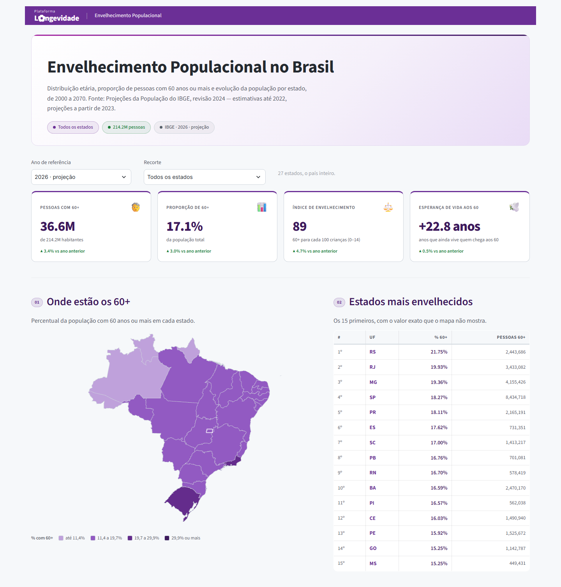

# Envelhecimento Populacional no Brasil

Este painel mostra **como a população de cada estado está distribuída por idade**, com atenção especial ao **envelhecimento**.

Os dados são as **Projeções da População do IBGE (revisão 2024)**:
- **de 2000 a 2022** são **estimativas** (o que aconteceu);
- **de 2023 a 2070** são **projeções** (o que se espera).

O painel sempre diz qual é qual. Atenção: **o ano atual já é projeção.**



**No ar:** <https://painel.cenarios.unb.br/cenarios/demografico-longevidade/>

## Relação com o painel demográfico

Este painel **nasceu como uma cópia** do [Painel Demográfico — Brasil](https://github.com/Dev-Cenarios/painel-demografico-brasil). Os dois andaram juntos até a chegada do mapa novo (em pydeck). Daí em diante, **cada um seguiu o seu caminho**.

Os dois continuam no ar, cada um no seu endereço e na sua porta.

**O que já é diferente neste:**
- endereço `/cenarios/demografico-longevidade`, porta 8508 no servidor e container `dashboard-demografico-longevidade`;
- o nome que aparece na tela;
- **a identidade visual**: a marca, a paleta roxa e as cores do mapa vêm do [longevidade.unb.br](https://longevidade.unb.br). Veja [Identidade visual](docs/identidade.md);
- **a base de dados**: aqui é a revisão 2024 do IBGE, por estado, de 2000 a 2070, com idade até **90 ou mais**.

## O que tem no painel

- **Mapa por quartis.** Os cortes das cores são **fixos para o período todo (2000 a 2070)**, então dá para ver o mapa **escurecer década a década**. O mapa não tem fundo nem depende de serviço de mapas externo.
  **Clicando num estado, o painel inteiro passa a mostrar os dados dele.** Clicando de novo, volta para o Brasil.
- **Tabela dos estados mais envelhecidos**, com o valor exato que o mapa não mostra.
- **Pirâmide etária**, em faixas de 5 anos até **90+**, separando homens e mulheres.
- **Distribuição por sexo**, na população toda ou só entre quem tem 60 anos ou mais.
- **Evolução da população de 2000 a 2070**:
  - **linha cheia** até 2022 (estimativa);
  - **linha tracejada** de 2023 em diante (projeção);
  - o **pico** fica marcado: a população do Brasil para de crescer e começa a cair **em 2041**.
- **Quatro números de destaque**, cada um comparado com o ano anterior:
  - quantas pessoas têm 60 anos ou mais;
  - a porcentagem de pessoas com 60+;
  - o índice de envelhecimento;
  - a esperança de vida aos 60 anos.

**O painel diz "60+", e não "idosos"**, em tudo que aparece na tela. O motivo está na [Documentação dos Gráficos](docs/DOCUMENTACAO_GRAFICOS.md).

## Filtros

Ficam **numa linha, logo abaixo do título** (não numa barra lateral). São dois:

- **Ano**: muda os números de destaque e os gráficos. A comparação com o ano anterior é feita sozinha.
- **Recorte**: todos os estados, uma região (Norte, Nordeste, Centro-Oeste, Sudeste, Sul) ou estados escolhidos um por um.

Além deles, tem a chave **"Apenas ≥ 60 anos"** dentro do gráfico de distribuição por sexo, porque ela só mexe nesse gráfico.

## Onde ler mais

| Documento | O que explica |
|---|---|
| [Metodologia](docs/metodologia.md) | **Comece por aqui:** de onde vem cada número, como é calculado e o que ele **não** diz. |
| [Arquitetura](docs/ARQUITETURA.md) | Como o dado chega na tela, para que serve cada parte do código, como é publicado e o que o painel ainda não faz. |
| [Documentação dos Gráficos](docs/DOCUMENTACAO_GRAFICOS.md) | Por que cada gráfico existe, como é calculado e o código. |
| [Identidade visual](docs/identidade.md) | A paleta roxa do Observatório: de onde veio cada cor e o que foi reprovado nos testes. |
| [Publicação no servidor](docs/deploy-vm.md) | Como subir no servidor: portas, rota do nginx e a "pegadinha" do caminho. |
| [Performance](docs/performance.md) | Quanto tempo cada parte leva, o que foi otimizado e os limites conferidos nos testes. |

## Ferramentas usadas

| Parte | Ferramenta |
|---|---|
| Tela do painel | Streamlit |
| Gráficos | Plotly (barras, pizza e linha) |
| Mapa | pydeck / deck.gl (`GeoJsonLayer`), **sem mapa de fundo**. O contorno dos estados já vem preparado em `data/ufs.geojson` |
| Dados | Arquivos Parquet do IBGE, lidos com pandas. O Streamlit guarda os resultados na memória (`@st.cache_data`) |

## Como rodar no seu computador

```bash
git clone https://github.com/Dev-Cenarios/painel-envelhecimento-brasil.git
cd painel-envelhecimento-brasil
pip install -r requirements.lock.txt
streamlit run app.py
```

Depois abra `http://localhost:8508/cenarios/demografico-longevidade`.

**Por que tem esse caminho no final:** o `.streamlit/config.toml` usa o mesmo caminho do servidor (`baseUrlPath`). Assim, **o que você vê no seu computador é igual ao que está no ar.**

**Versão do Python:** roda em **Python 3.13**. Antes não rodava, porque o `pandas` só passou a ter versão pronta para o 3.13 a partir do 2.2.3. Até lá, só dava para desenvolver usando Docker. **O servidor continua em Python 3.11** (`python:3.11-slim`).

**No Windows,** é só dar dois cliques no `rodar_dashboard.bat`. Na primeira vez ele prepara o ambiente e depois abre o painel.

## Testes e scripts

```bash
pip install -r requirements-dev.txt
pytest                                # os 113 testes: números, malha, mapa, identidade e tempo
pytest -m "not tempo"                 # os 110 que o CI roda (sem os de tempo)
python -m scripts.medir_performance   # mede o tempo de cada parte, sem a memória do Streamlit
python -m scripts.preparar_geometria  # gera data/ufs.geojson de novo, a partir do contorno cru
```

**O `preparar_geometria` só precisa rodar se o contorno de origem mudar.** O resultado já está salvo no repositório. É o único script que usa `geopandas` e `topojson`, por isso essas duas bibliotecas ficam no `requirements-dev.txt` e **não entram na imagem do servidor**.

**Por que os testes de tempo ficam fora do CI:** eles medem o tempo no relógio e comparam com um limite fixo. Numa máquina compartilhada do GitHub, o tempo diz mais sobre **quanto a máquina está ocupada com outras coisas** do que sobre o nosso código. A explicação completa está no `pytest.ini`.

## Dependências (as bibliotecas que o painel usa)

| Arquivo | Para que serve |
|---|---|
| `requirements.txt` | O que o painel **precisa**: as **5 bibliotecas** que o código usa direto (streamlit, plotly, pandas, pyarrow e pydeck). |
| `requirements.lock.txt` | O que está **instalado de verdade**: as **39 bibliotecas** com a versão exata. É daqui que o Dockerfile instala. |

**Por que dois arquivos?** Cada biblioteca puxa outras junto (altair, numpy, protobuf, pillow…). As diretas já tinham versão fixa, mas essas "puxadas" não tinham. Assim, dois builds do mesmo código podiam sair com versões diferentes. O lock trava todas. Ele foi copiado do container que já estava rodando, para que travar as versões não mudasse nada no painel publicado.

O `pydeck` virou dependência direta quando o mapa saiu do Plotly. Antes ele já vinha "puxado" pelo streamlit.

**Se você mudar o `requirements.txt`**, gere o lock de novo com:

```bash
docker run --rm -v "$PWD:/w" -w /w python:3.11-slim \
  sh -c "pip install -q -r requirements.txt && pip freeze" > requirements.lock.txt
```

Rode **dentro do Docker** (`python:3.11-slim`), não com o Python do seu computador. Cada versão do Python escolhe versões diferentes das bibliotecas, e a que vale é a do servidor.

## Verificação automática (CI)

A cada envio para o GitHub (push ou pull request), o [`.github/workflows/ci.yml`](.github/workflows/ci.yml) roda sozinho:

1. `ruff check .`: procura erros no código;
2. `pytest -m "not tempo"`: os testes, menos os de tempo;
3. monta a imagem Docker;
4. compara as bibliotecas instaladas na imagem com o lock.

**O que os testes conferem:** o tamanho e o enquadramento do mapa, as cores, a identidade visual e, no `tests/test_numeros.py`, **os números oficiais do IBGE**: totais de 2010, 2025 e 2070, o pico em 2041, a esperança de vida aos 60 do Brasil e a idade máxima da pirâmide.

**O que o CI não pega:** um gráfico que ficou feio. Para isso, ainda é preciso abrir o painel e olhar.

## Dados

**Projeções da População do IBGE, revisão 2024**, por estado, idade (ano a ano, de 0 a **90 ou mais**) e sexo, de 2000 a 2070.

São dois arquivos em `data/`, gerados pelo `scripts/preparar_projecao.py` a partir das planilhas do site (FTP) do IBGE:

| Arquivo | Vem de | O que tem |
|---|---|---|
| `pop_uf.parquet` (0,9 MB) | `projecoes_2024_tab1_idade_simples.xlsx` | população por estado (`uf`), `ano`, `sexo` e `idade` |
| `indicadores_uf.parquet` | `projecoes_2024_tab4_indicadores.xlsx` | esperança de vida ao nascer e aos 60 anos, por sexo |

**Quando o IBGE publicar uma revisão nova:**

```bash
python scripts/preparar_projecao.py <pasta com as planilhas>
```

**Até 15/set/2026, a base era por município** (23 MB) e vinha de um processo fora deste repositório. Como **o painel nunca usou município** (todo gráfico soma por estado), a base foi trocada, e a troca foi conferida número por número. Veja o [Levantamento das projeções](docs/historico/levantamento-projecoes.md).

## Como as pastas estão organizadas

```
painel-envelhecimento-brasil/
├── app.py                     # arquivo principal: filtros e montagem da tela
├── src/
│   ├── charts.py              # os gráficos (Plotly)
│   ├── mapa.py                # o mapa (pydeck)
│   ├── data.py                # lê os dados e guarda na memória
│   ├── themes.py              # as cores do tema claro e escuro
│   └── utils.py               # formatação de números e pedaços de HTML
├── scripts/
│   ├── preparar_projecao.py   # planilhas do IBGE → data/*.parquet
│   ├── preparar_geometria.py  # contorno cru → data/ufs.geojson
│   └── medir_performance.py   # mede o tempo de cada parte
├── data/
│   ├── pop_uf.parquet           # população por estado, ano, sexo e idade
│   ├── indicadores_uf.parquet   # esperança de vida
│   ├── ufs.geojson              # contorno dos estados, já preparado (95 KB): é o que o painel usa
│   └── brazil-states.geojson    # contorno cru (3,3 MB): só serve de origem para o ufs.geojson
└── requirements.txt
```

## Como citar e licença

Se usar o painel ou o código num trabalho, use o botão **"Cite this
repository"** aqui no GitHub, que lê o [`CITATION.cff`](CITATION.cff).

O código é aberto, sob a licença [MIT](LICENSE): pode ser usado, copiado e
adaptado, desde que o aviso de copyright do Projeto Cenários vá junto. A
licença vale para o código. Os dados são do IBGE, e seguem as regras da fonte.
